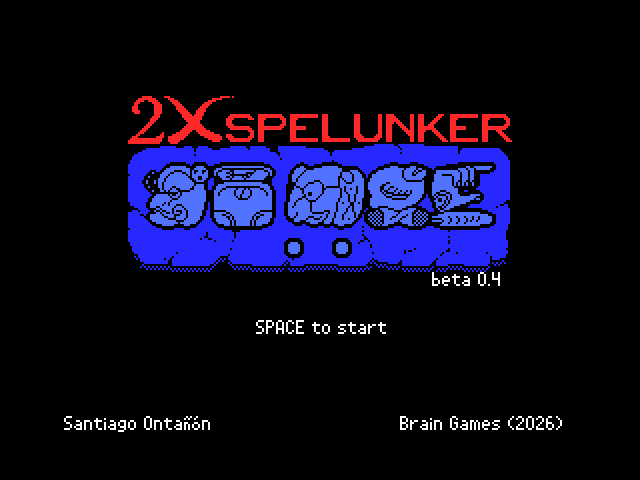
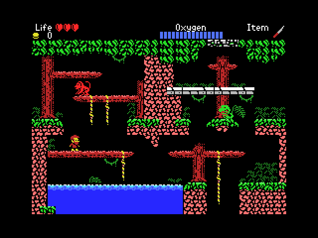
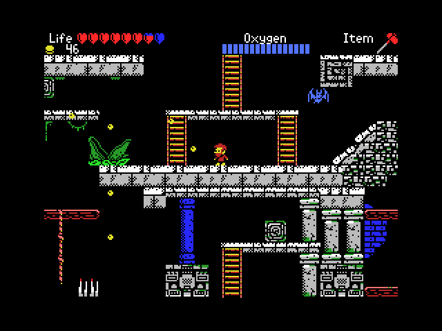
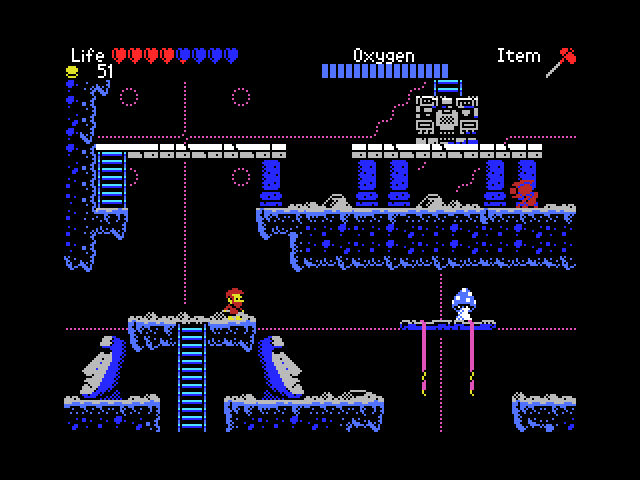
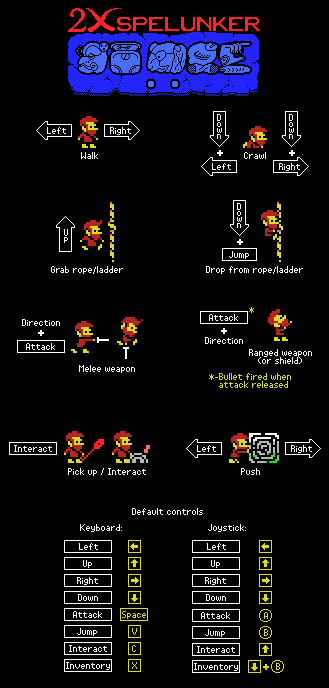

# X-Spelunker 2 (MSX)

- Code / Graphics / Music: Santiago Ontañón 
- Beta testing: Jordi Sureda, Xavi Sorinas

You will need an MSX emulator to play the game on a PC, for example OpenMSX: http://openmsx.org

## Introduction

X-Spelunker 2 is an MSX1 game, in a 512KB MegaROM cartridge format, using the ASCII16-X mapper (see https://www.grauw.nl/projects/ascii-x/ascii16-x/). X-Spelunker 2 continues the story of X-Spelunker (https://github.com/santiontanon/xspelunker). However, despite the surface similarities, X-Spelunker 2 is a completely different game. While X-Spelunker is a small roguelite (inspired by Spelunky), X-Spelunker 2 is a large metroidvania game, inspired by games like La Mulana and Tunic, with many biomes and bosses. you can expect finding many secrets and riddles throughout the game. You do not need to solve most of them to beat it, but you will have to solve most of them if you want to get the "good ending".

As you will notice the first time you play, the map generation is procedural, but you can specify a world name, which determines the random seed for your run. If you are playing for the first time, I recommend using the default seed until you understand the game, and you know what you are doing when changing the world name.

## Screenshots

Screenshots:

 

 

You can see a video of the game in Youtube: https://youtu.be/5gMvcYiBDw0

## Instructions

In X-Spelunker 2 you play the role of Michael S. Xavier, an explorer who adventures again into the Maya territory in Yucatan to investigate some mysterious Mayan ruins. As mentioned above, X-Spelunker 2 is a Metroidvania / Metroidbrainia game, and hence it is not designed to be completed in a single gameplay session. You can save your game from the inventory screen anytime in the game as long as there are no enemies or other danger around in the current room.

Controls:

